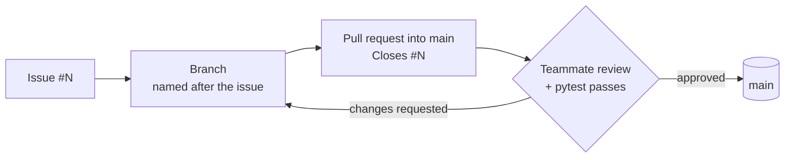

<div align="center">




<br><br>


**[Overview](#overview)** ·
**[Question](#research-question)** ·
**[Conditions](#the-four-conditions)** ·
**[How a run works](#how-a-run-works)** ·
**[Scenarios](#scenarios)** ·
**[File formats](#file-formats)** ·
**[Metrics](#what-we-measure)** ·
**[Models](#models)** ·
**[Architecture](#architecture-tools-and-flow)** ·
**[Quickstart](#quickstart)** ·
**[Glossary](#glossary)** ·
**[Team](#team)**

</div>

---

## Overview

- **The question:** does a second look make an AI financial advisor more reliable, and is it worth what it costs?
- **The experiment:** one advisor (`gemini-3.6-flash`) drafts an answer, then four verification strategies (none, self, peer, and a dedicated verifier with a calculator) check the same draft, plus two ablations (no calculator; a verifier from another company).
- **The grading:** synthetic client scenarios with known answers, graded by a deterministic scorer that no agent ever sees.
- **The goal:** find out which kind of check makes the advisor most reliable, and what each one costs in tokens and time.

> [!NOTE]
> **Status: in progress (November 17).**
> - **Merged:** scenarios S01–S10 and the first variant (T03-v001); the checker and seeded error set; the model wrapper (`llm.py`: logging, retries, pricing, $20 spending cap, Groq provider, finish reasons); the calculator; every prompt and verifier (self, peer, dedicated with the calculator, weakened, cross-family); the pipeline with the `none` condition; the model pilot and its write-up (`docs/pilot.md`); metrics, the results report and the spending report.
> - **Done:** the `none` baseline (gemini-3.6-flash, S01–S10 × 5): **84% (42/50)**, no format failures, $0.90.
> - **In review:** `self` and `peer` in the pipeline (#33).
> - **Next:** wire the dedicated, weakened and cross-family verifiers into the pipeline, more scenario variants, then the main runs.

## Research question

> **How do different verification strategies affect the correctness of a multi-agent financial advisory system on synthetic client scenarios?**

In plain words: *does a second look make an AI advisor more reliable, and is it worth what it costs?*

LLM agents can draft financial advice in seconds, and they sound just as confident when the arithmetic is wrong or a client's rule is broken. A client who acts on that advice loses real money. This project holds everything else fixed (scenarios, advisor model, prompts, the advisor's first draft) and changes one thing: **how the answer is verified**. Every answer is graded by a deterministic constraint checker that is never shown to any agent.

**Questions the study explores**

- Which verification strategy catches the most errors, and which one breaks the fewest correct answers?
- Does giving the verifier a calculator matter, and does a verifier from a different model family catch mistakes the advisor's own family misses?
- How much does each strategy cost per extra correct answer?
- Should the verifier be a stronger model than the advisor?

> [!IMPORTANT]
> `src/advisory/checker.py` and the scenario answer keys are for the scorer only. Keep them out of every prompt and every agent code path, so no agent can see what it is graded on.

## The four conditions

|     | Condition   | Who verifies              | What happens                                                                 |
|:---:|-------------|---------------------------|------------------------------------------------------------------------------|
| ⚪  | `none`      | Nobody                    | The advisor answers once; its output is final (baseline).                    |
| 🔁  | `self`      | The advisor itself        | The advisor reviews and revises its own answer.                              |
| 👥  | `peer`      | Another advisor           | A second, independent advisor in the same role critiques; the first revises. |
| 🛡️  | `dedicated` | A separate verifier agent | A verifier with its own prompt and a **sandboxed Python calculator** checks both the math and the rules. |

All four live in the `CONDITIONS` registry in `src/advisory/conditions.py`. One general advisor with the same prompt answers in every condition, and plain Python runs the workflow (no router agent), so any difference in results comes from verification alone.

**Verdicts.** Every checked answer ends in one of three outcomes:

| Verdict | What happens next |
|---|---|
| **Accept** | The draft becomes the final recommendation. |
| **Reject** | The advisor revises **once**, and the same verifier checks the revision once. The revision is the final answer. |
| **Abstain, an unreadable verdict, or anything but accept after the revision** | The task goes to a **human review** queue. |

Every run ends with a final answer and a status: **accepted**, **revised**, **human_review**, **unchecked** (the `none` condition) or **failed** (an API call failed). The `verdict` column always holds the **first** verdict, which is what catch rate and false alarms are measured against. An unreadable verifier reply is stored as a missing verdict, never guessed.

Self, peer and dedicated use the **same review instructions, verdict format and revision prompt** (`src/advisory/prompts.py`), so differences between conditions come from who reviews and the calculator, not from wording.

**Ablations.** To find out *why* the dedicated verifier works, it runs twice more with one thing changed:
- **Weakened verifier:** the dedicated verifier **without the calculator** (same role, instructions and verdict format, one call).
- **Cross-family verifier:** the dedicated verifier played by OpenAI's open-weight **`gpt-oss-20b` on Groq**, a different company than the advisor.

## How a run works

<p align="center">
  
</p>

<sub>**What the animation shows:** each gold dot is one scenario run. It leaves the scenario generator, passes through the advisor, takes one of the four verification paths (the highlighted lane), reaches the final answer and ends at the hidden checker. The dashed red line is the ground truth, which travels straight from the generator to the checker without touching any agent. The bars in the log strip light up as model calls are recorded.</sub>

<p align="center">
  
</p>

<sub>**Static version for the report:** the same flow with all six conditions, the review outcomes and the seeded error set. `docs/study_design.png` is a 2400×1520 render for slides and the PDF.</sub>

1. **Scenario.** Each task is a scenario file in `data/scenarios/` with a hidden answer key in `data/evaluation/`. The ten templates and the first variant are built by hand; a seeded generator is planned (`generator.py` is still a stub).
2. **Draft once.** The advisor answers with the shared `advisor-v1` prompt, following the scenario's `NEUTRAL_OUTPUT_V1` contract. The draft is **saved once per task and repeat (`results/drafts/`), then reused in every condition**.
3. **Verify.** The selected condition checks the draft (or doesn't) and produces the final answer: accepted, revised once, or sent to human review.
4. **Grade.** `checker.py` replays the trades at the quoted prices and tests every constraint against the hidden answer key. It grades **both the first draft and the final answer**, which is how fixed answers are told apart from broken ones. Any valid solution passes, not just one fixed answer.
5. **Log.** Every model call goes through `advisory.llm.call_model` and is appended to `results/runs.jsonl`, with tokens, cost and timing.

## Scenarios

The study starts from **10 scenario templates (S01–S10): 4 medium, 4 hard and 2 infeasible**, and grows by adding variants of them (IDs like `T03-v001`, the first variant of S03). How many tasks the main runs use is set by the budget: about 30 tasks fit the $20 cap with room for reruns. Each scenario gives the advisor a natural client request plus separate structured data: the client profile, investment policy, portfolio holdings, asset prices, cash flows and restrictions. Everything is synthetic, and no real client data is used.

| Answer type | What the advisor must return |
|---|---|
| **TRADE_PLAN** | Trades as share changes (`quantity_delta`), or no trades when the request can't be met |
| **VIOLATION_LIST** | Every rule the portfolio currently breaks |
| **NUMERIC_RESULT** | Calculated values, such as fees, net returns or a retirement projection |

Every answer also carries a **status**: `FEASIBLE`, `INFEASIBLE`, `VIOLATIONS_FOUND` or `INSUFFICIENT_INFORMATION`.

**Trading assumptions:** fixed quoted prices, no transaction fees or taxes, no short selling, no borrowing, no deposits beyond those listed in the scenario, and whole shares wherever the scenario requires them.

**What each part sees:** agents receive the complete scenario file and their role prompt, nothing else. The evaluation files are read only by the scorer.

<details>
<summary><b>The ten scenario templates</b></summary>

| ID | Request | Difficulty | Answer type |
|---|---|---|---|
| S01 | Rebalance to 60/30/10, never sell AAPL | Medium | TRADE_PLAN |
| S02 | Fund a $25,000 expense, keep $12,000 cash | Medium | TRADE_PLAN |
| S03 | Find the five policy violations | Medium | VIOLATION_LIST |
| S04 | Compare two funds after fees | Medium | NUMERIC_RESULT |
| S05 | Rebalance under 25% stock and 35% tech caps | Hard | TRADE_PLAN |
| S06 | Retirement balance at month 240, extra contribution | Hard | NUMERIC_RESULT |
| S07 | Rebalance at new prices after a $12,000 deposit | Hard | TRADE_PLAN |
| S08 | Withdraw $20,000, then rebalance to 50/37.5/12.5 | Hard | TRADE_PLAN |
| S09 | Reach 40/50/10 without selling stock | Infeasible | TRADE_PLAN |
| S10 | Withdraw $80,000 | Infeasible | TRADE_PLAN |

S09 and S10 are infeasible on purpose: the right answer is the `INFEASIBLE` status with no trades, backed by the supporting numbers.

</details>

## File formats

**Scenario file** (`data/scenarios/S01.json` …, given to every agent unchanged)

| Field | What it holds |
|---|---|
| `scenario_id`, `schema_version`, `answer_type` | Identity of the task |
| `client` | Age, risk profile, goal and horizon, where relevant |
| `portfolio` | Holdings (symbol, asset class, quantity, price, value), cash and total value |
| `investment_policy` | Target allocations, restrictions and allocation tolerance |
| `cash_flows` | Listed deposits and withdrawals |
| `client_request` | The client's request in plain language |
| `assumptions` | The approved trading assumptions |
| `output_requirements` | The output contract the answer must follow |

**Answer format** (`NEUTRAL_OUTPUT_V1`, one contract for every scenario and condition)

| Field | What it holds |
|---|---|
| `status` | `FEASIBLE`, `INFEASIBLE`, `VIOLATIONS_FOUND` or `INSUFFICIENT_INFORMATION` |
| `trades` | `[{symbol, quantity_delta}]`: positive to buy, negative to sell, `[]` when no trades are proposed |
| `metrics.observations` | Reported numbers, each identified by subject, measure, stage and rounding |
| `metrics.selection` | The chosen option when the client compares named options, otherwise `null` |
| `violations` | `[{kind, scope, observed, limit}]` for policy audits |
| `explanation` | A short explanation of the recommendation and calculation |

**Evaluation files** (scorer only)

| File | What it holds |
|---|---|
| `checks.json` | The checks for each scenario, such as schema, status, trade replay, independent results and exact violations |
| `ground_truth.json` | Reference results for each scenario |
| `metric_mapping.json` | How the scorer derives each number from the scenario and the answer |

The scorer never fills in a reference value for a number the advisor failed to report. The underlying data model has 17 tables, covering clients and portfolios, policies, tasks and answer keys, and runs and results.

**Per-run results** (`results/results.jsonl`, written by `pipeline.py`, input to `metrics.py`, one row per run): `task_id`, `condition`, `run_number`, `model`, settings and prompt versions, `initial_correct`, `final_correct`, format failures, `initial_status_correct` / `final_status_correct`, `verdict`, `status`, `error`, and the run's `tokens_in`, `tokens_out`, `cost_usd`, `latency_s` (including the shared draft). With #33, each graded run also saves its draft, revision, final answer, verifier replies and both checker results to `results/answers/<run_id>.json`.

**Seeded reviews** (`results/seeded/<run_id>.json`, written by `seeded.py`, one file per review): each checked condition's verifier reviews every answer in `data/injected/` once per run number, with no revision. Each record has `answer_id` (joins to `data/evaluation/seeded_error_labels.csv`), `scenario_id`, `error_type`, `seeded_error` (false for the 14 correct controls), `condition`, `run_number`, the settings, `verdict`, `status` and a one-entry `reviews` list with the same fields as `results/answers/`. Run IDs look like `seeded-dedicated-gemini-3.6-flash-S01_policy_violation_sell_aapl-r1`, so seeded calls never mix with the main runs in the run log.

## What we measure

Metrics come from `src/advisory/metrics.py`, which turns one row per run into one row of metrics per condition with `summarize(runs, seed=0)`.

| Group | Metric | What it tells us |
|---|---|---|
| **Outcome** | **Task success** | Share of final answers that pass the checker, with a 95% bootstrap confidence interval |
| **Verifier** | **Catch rate** | Share of wrong drafts the verifier flags |
| | **Precision** | Share of flags that point at a real error |
| | **False-alarm rate** | Share of correct drafts the verifier wrongly flags |
| | **MCC** | One balanced score for how well the flags separate wrong drafts from correct ones |
| | **Abstention rate** | Share of scored verdicts that are `abstain` (sent to human review) |
| **Fixed vs broken** | **Fix rate** | Share of wrong drafts that end up correct after verification |
| | **Break rate** | Share of correct drafts that verification turns wrong |
| | **Net gain** | Fix rate minus break rate |
| | **Success delta** | (fixed − broken) ÷ all runs, i.e. final success minus first-draft success |
| **Cost** | **Cost, tokens and latency** | Total and mean cost, mean tokens, median and p95 latency |
| | **Extra cost per extra correct answer** | (mean cost − mean cost of `none`) ÷ (success rate − success rate of `none`) |

Verifier metrics use runs that have a verdict, and an abstain counts as a flag, just like a reject. Runs without a verdict are counted in `n_missing_verdict`, which is `None` for `none` because it has no verifier by design. Rates that can't be computed are reported as `None`, and so is MCC. Net gain and success delta are reported together because net gain can be positive while overall success drops. Extra cost per extra correct answer is `None` when a condition is not more accurate than `none`.

**Study settings**

- **Repeats:** every scenario runs 5 times per condition, at temperature 0.7 so repeats can differ.
- **Statistics:** the bootstrap resamples tasks, not runs, and conditions are compared in pairs on the same tasks.
- **Settings:** temperature 0.7, top-p 0.9, the model's default thinking level. Results made with other settings or prompt versions are refused, so runs can't be mixed by accident.
- **Budget:** **$20** for the whole project. `llm.py` refuses a paid call that could take total logged spend past `ADVISORY_BUDGET_USD` (default 20) before it is sent. That spend is summed from the local, gitignored `results/runs.jsonl`, so **the cap is enforced per machine**. The rule: **all paid study runs go through one machine and key (Bhoomika's); everyone else uses their own free keys for testing.** The paid key also has prepaid Google credit with auto-reload off, a hard limit on Google's side. `python scripts/spend.py` shows spend so far.
- **Projected cost:** about **$10 for 20 tasks, $14 for 30 and $19 for 40** (6 settings × 5 repeats). This is an estimate from calls logged on Nov 13–17: a first draft costs $0.018 (the 50 baseline runs and 30 pilot runs), a gemini-3.6-flash verifier call $0.0076 (8 live verifier checks), a gpt-oss-20b call $0.001 (6 live checks). It assumes a quarter of first verdicts are rejects that trigger a revision. To be updated once real self and peer runs exist.
- **Something to catch:** a model that never makes mistakes leaves verification nothing to do, and one that breaks the output format fails before the math matters. The advisor model was chosen with a pilot so that it is right most but not all of the time, and answers with **known injected errors** (`data/injected/`) are added so every verifier faces real mistakes.

## Models

Every model call goes through `advisory.llm.call_model`. Gemini and Gemma use the Gemini API (`GOOGLE_API_KEY`); gpt-oss-20b uses Groq (`GROQ_API_KEY`). Prices are per 1M tokens, and the output price includes thinking tokens.

| Model | Provider | Input / output | Role |
|---|---|---|---|
| **`gemini-3.6-flash`** | Gemini API | $0.75 / $3.75 (doubles on 2027-01-01) | **Advisor and same-family verifiers** (chosen by the pilot) |
| `openai/gpt-oss-20b` | Groq | $0.075 / $0.30 | **Cross-family verifier** |
| `gemini-3.5-flash-lite` | Gemini API | $0.30 / $2.50 | Advisor candidate, 30% in the pilot |
| `gemini-3.1-flash-lite` | Gemini API | $0.25 / $1.50 | Advisor candidate, 3% in the pilot |
| `gemini-3.8-flash` | Gemini API | $0.75 / $3.75 | Advisor candidate, not used |
| `gemma-4-31b-it`, `gemma-4-26b-a4b-it` | Gemini API | free tier only | Earlier cross-family candidates (Google-built) |

- **Model pilot:** `gemini-3.6-flash` was right on **83% (25/30)** of pilot runs (S01–S10 × 3, `none`, prompt `advisor-v1`), with every answer valid JSON. Its errors were arithmetic slips on S04, S06 and S07. That's just above the 50–80% target; the injected-error set makes sure every verifier still faces errors. Details: [`docs/pilot.md`](docs/pilot.md).
- **Why not the proposal's models:** Gemini 2.5 Flash and Flash-Lite now return *"no longer available to new users"*, so the candidates moved to the Gemini 3.x family.
- **Why gpt-oss for cross-family:** Gemma is also built by Google and may share Gemini's blind spots; gpt-oss-20b comes from another company and was a candidate in the proposal. Groq's limits on our account are 8,000 tokens a minute and 200,000 a day ([rate limits](https://console.groq.com/docs/rate-limits), checked Nov 17), about 15–25 verifier reviews a day, so the cross-family runs take several days.
- **Cost is never undercounted:** `llm.py` refuses any model without a `PRICING` entry, and logs a deliberately high estimate when a provider reports no output tokens for a reply that has text (#36).
- **Baseline:** `none` on S01–S10 × 5 was right on **84% (42/50)** (95% bootstrap interval over tasks 60–100%), with no format failures and no failed calls, for $0.90. All 8 errors are on S04 and S06, so the advisor gives the verifiers only two distinct real errors; the seeded error set supplies the rest.
- **Free tier:** gemini-3.6-flash allows 20 requests a day per model there; the main runs need the paid tier.

## Architecture, tools and flow

<p align="center">
  
</p>

<sub>**What the animation shows:** one task plays through three lanes in a loop of about 14 seconds. **Develop:** a change moves from a teammate's branch through a pull request and pytest (a ✓ appears) into main. **Run:** the task drops into `scripts/`, then passes through the generator and the scenario files into `conditions.py`, where the four conditions light up in turn, and on to `llm.py`, which exchanges calls with the LLM API. **Evaluate:** the final answer and the red ground-truth line meet at `checker.py` (a ✓ appears), run logs flow from `runs.jsonl`, and both feed the metrics and the report. The pills and the progress bar at the top show which lane is playing.</sub>

| Layer | Tools |
|---|---|
| **Develop** | Git branches, GitHub pull requests, `pytest` |
| **Run** | Python 3.10+, a sandboxed Python calculator for the dedicated verifier, Gemini and Groq APIs through `advisory.llm.call_model`, keys in `.env` |
| **Data** | JSON scenarios in `data/scenarios/`, JSONL run logs in `results/` |
| **Evaluate** | Deterministic `checker.py`, `metrics.py` (with scikit-learn), analysis entry points in `scripts/` |

**Who reads and writes what**

| Component | Reads | Writes |
|---|---|---|
| Scenario author (generator planned) | Templates | Scenario files (public) and evaluation files (private) |
| Advisor | Scenario file + advisor prompt | First draft, then at most one revision |
| Verifier | Scenario file + draft + verifier prompt (`dedicated` and cross-family also have the calculator; weakened has none) | Verdict, issues and a reason |
| `llm.py` | Every prompt and response | `results/runs.jsonl` |
| Scorer | Scenario file + draft and final answers + evaluation files | Per-run results |
| `metrics.py` | Per-run results | One row of metrics per condition |

Two rules hold everywhere: no agent ever reads the evaluation files, and the scorer only writes results; it never changes an answer.

## Repository layout

```text
src/advisory/
  llm.py          single wrapper for every model call; logging, retries, pricing, $20 cap
  prompts.py      every prompt: advisor, self/peer review, revision, dedicated verifier
  verdict.py      parses a verifier's accept / reject / abstain reply
  dedicated.py    the dedicated verifier's calculator loop
  calculator.py   sandboxed calculator tool for the dedicated verifier
  drafts.py       first drafts: written once, reused by every condition
  conditions.py   the conditions and the CONDITIONS registry
  pipeline.py     runs one condition on one task, grades it, saves a results row
  checker.py      deterministic constraint checker (hidden from agents)
  evaluation/     reference answers for the checker's tests (scorer only)
  inject.py       builds the seeded error set
  seeded.py       verifier reviews of the seeded error set
  metrics.py      per-condition metrics: task success, verifier, fixed vs broken, cost
  report.py       summary tables, per-scenario tables and a chart from the results
  spend.py        spending totals from the run log (used by scripts/spend.py)
  pilot.py        model pilot: picks the advisor model
  generator.py    scenario generator (planned)
  schemas.py      early Pydantic answer models (the live contract is NEUTRAL_OUTPUT_V1)
scripts/
  run_pilot.py      model pilot (resumable after the daily quota)
  spend.py          spending so far, by model, condition and day
  run_condition.py  run one condition over a set of tasks (resumable)
  run_seeded.py     one condition's verifier reviews the seeded answers (resumable)
  analyze.py        build the report from results/results.jsonl
tests/            pytest suite
data/scenarios/   scenario files (S01.json … S10.json, T03-v001.json), given to agents
data/evaluation/  checks, ground truth and metric mapping (scorer only, never given to agents)
data/injected/    answers with known injected errors, plus correct controls
results/          runs.jsonl (every model call), results.jsonl (one row per run), drafts/, answers/, seeded/, pilot/, report/
docs/             proposal.pdf, topic_selection.pdf, CS5130_progress_report.pdf, pilot write-up, study_design.svg/.png (report diagram)
assets/           README images and animations
pyproject.toml    package metadata and dependencies (pip install -e ".[dev]")
.env.example      template for your local .env (API keys)
.gitignore        keeps .env, caches and local files out of git
```

## Quickstart

```bash
git clone https://github.com/bhoomi02-ai/cs5130-verification-advisory.git
cd cs5130-verification-advisory
python3 -m venv .venv
source .venv/bin/activate
pip install -e ".[dev]"
cp .env.example .env   # make your own copy, then edit .env (not .env.example)
pytest
```

Then open `.env` and add your keys: Gemini from [Google AI Studio](https://aistudio.google.com/apikey), and Groq from the [Groq console](https://console.groq.com/keys) if you run the cross-family verifier:

```bash
GOOGLE_API_KEY=your-key-here
GROQ_API_KEY=your-key-here      # only for the cross-family verifier
ADVISORY_BUDGET_USD=20          # total spending cap; change only if the team agrees
```

Requires **Python 3.10 or newer**. Typical commands:

```bash
python scripts/run_pilot.py --dry-run                     # show the pilot plan, no calls
python scripts/spend.py                                   # spend so far against the cap

# Makes PAID calls (about $0.90 for this command): run only on the paid-run machine.
python scripts/run_condition.py --condition none --model gemini-3.6-flash \
    --tasks S01 S02 S03 S04 S05 S06 S07 S08 S09 S10 --repeats 5

# After at least one condition run (it reads results/results.jsonl):
python scripts/analyze.py                                 # tables and chart in results/report/
```

**Main study tasks.** The 32 tasks of the main study are listed in `data/study_tasks.txt`; pass `--tasks-file data/study_tasks.txt` (with `--repeats 3`) so every condition runs the exact same set.

After a daily quota stops a run, `run_condition.py` skips the runs already saved when you run the same command again, and `run_pilot.py` continues a batch with `--resume <batch_id>`.

**Study data.** Run outputs in `results/` are gitignored on `main` and are written on the paid-run machine. After each batch they are backed up to the separate, results-only **`study-results`** branch (no code; never merged into `main`). That branch has no `.gitignore`, so files are added normally there. Never use `git add -f` to put results on `main`. To get the data:

```bash
git fetch origin study-results
git archive origin/study-results results | tar -x    # into your results/, which git ignores
```

> [!WARNING]
> Keys go only in `.env`, which git ignores. `.env.example` is tracked by git, so never put a real key in it. Never commit `.env` or any API key. If a key is ever pushed, revoke it right away; deleting the commit is not enough.

## Contributing workflow



- **One branch per task**, named after the issue, e.g. `generator/scenario-schema`.
- **Open a pull request into `main`** and link the issue (`Closes #N`).
- **At least one teammate reviews** before merging, and `pytest` must pass.
- **Every model call goes through `advisory.llm.call_model`** so it is logged.
- **Use exact model names**, never aliases such as `-latest`, so runs are reproducible. Gemini model names have no date suffix, so the exact name is the pin, and every run logs the model it used.

## About the animated diagrams

All images live in `assets/` as self-contained SVG files. They animate on their own, with no scripts or outside services, so they play anywhere GitHub shows the README.

| File | What it shows |
|---|---|
| `banner.svg` | The project title, with the advisor sending answers through the four checkers to the hidden checker |
| `tagline.svg` | Three lines typed out in a loop: the question, the setup, and what is measured |
| `pipeline.svg` | One scenario run through the four verification paths, with the hidden ground truth and the log |
| `architecture.svg` | The whole system as a story: develop, run, evaluate |

## Glossary

| Term | Meaning |
|---|---|
| **Advisor** | The AI agent that drafts the answer to a client request |
| **Verifier** | The agent that checks a draft: the advisor itself (`self`), a second advisor (`peer`) or a separate verifier with a calculator (`dedicated`) |
| **Condition** | One way of verifying an answer; the study compares four |
| **Ablation** | A variant of the dedicated verifier with one setting changed, to see which part matters |
| **Scenario** | One synthetic client task with a known correct answer |
| **First draft** | The advisor's first answer, saved once and reused across conditions |
| **Verdict** | The verifier's decision: accept, reject or abstain |
| **Abstain** | The verifier declines to decide, and the task goes to human review |
| **Scorer / checker** | The deterministic program that grades answers against hidden checks |
| **Ground truth** | The reference results, seen only by the scorer |
| **Catch rate** | Of the wrong drafts, the share the verifier flagged |
| **False alarm** | A correct draft the verifier flagged anyway |
| **Fixed / broken** | A wrong draft that ended up correct, or a correct draft that ended up wrong |
| **MCC** | Matthews correlation coefficient: one score for how well flags line up with real errors |
| **`quantity_delta`** | A trade expressed in shares: positive to buy, negative to sell |
| **`NEUTRAL_OUTPUT_V1`** | The answer format every agent must follow |

## Responsible use

> [!CAUTION]
> This is a research prototype. Outputs are decision support on synthetic scenarios, not financial advice, and say nothing about real clients. No real client data is used, and the verifier can abstain and send a task to human review when it cannot confirm a claim.

## Team

<table align="center">
  <tr>
    <td align="center" width="25%"><b>Bhoomika Monthy Rajashekar</b><br><sub><a href="https://github.com/bhoomi02-ai">@bhoomi02-ai</a></sub></td>
    <td align="center" width="25%"><b>Dhanya Kini Bailoor</b><br><sub><a href="https://github.com/dhanyakini">@dhanyakini</a></sub></td>
    <td align="center" width="25%"><b>Faisal Alsabih</b><br><sub><a href="https://github.com/FaisalNAlsabih">@FaisalNAlsabih</a></sub></td>
    <td align="center" width="25%"><b>Tejas Prashant Vanjari</b><br><sub><a href="https://github.com/vanjaritejas">@vanjaritejas</a></sub></td>
  </tr>
</table>

---

<div align="center">
<sub>Northeastern University · CS 5130 · Theme 6: Agentic Systems</sub>
</div>
