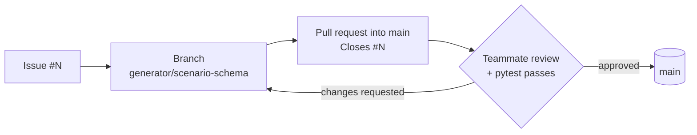

<div align="center">


<br><br>


**[Research question](#research-question)** ·
**[Conditions](#the-four-conditions)** ·
**[How a run works](#how-a-run-works)** ·
**[Metrics](#what-we-measure)** ·
**[Quickstart](#quickstart)** ·
**[Layout](#repository-layout)** ·
**[Workflow](#contributing-workflow)** ·
**[Architecture](#architecture-tools-and-flow)** ·
**[Team](#team)**

</div>

---

## Research question

> **How do different verification strategies affect the correctness of a multi-agent financial advisory system on synthetic client scenarios?**

LLM agents can draft financial advice in seconds, and they sound just as confident when the arithmetic is wrong or a client's rule is broken. We hold everything else fixed (scenarios, advisor model, prompts) and change one thing: **how the answer is verified**. Every final answer is graded by a deterministic constraint checker that is never shown to any agent.

> [!IMPORTANT]
> `src/advisory/checker.py` is the answer key. Keep it out of every prompt and every agent code path, so no agent can see what it is graded on.

## The four conditions

|     | Condition   | Who verifies              | What happens                                                        |
|:---:|-------------|---------------------------|---------------------------------------------------------------------|
| ⚪  | `none`      | Nobody                    | The advisor answers once; its output is final.                      |
| 🔁  | `self`      | The advisor itself        | The advisor reviews and revises its own answer.                     |
| 👥  | `peer`      | Another advisor           | A second advisor in the same role critiques; the first revises.     |
| 🛡️  | `dedicated` | A separate verifier agent | A verifier with its own prompt checks the answer before it is final. |

All four live in the `CONDITIONS` registry in `src/advisory/conditions.py`, so every condition runs on exactly the same scenarios.

## How a run works

<p align="center">
  
</p>

1. **Generate.** `generator.py` builds a synthetic scenario (client profile, holdings, prices, policy rules) with a known correct answer and saves it to `data/scenarios/`.
2. **Advise.** The advisor returns a structured recommendation (`Trade`, `Claim` and `Recommendation` in `schemas.py`).
3. **Verify.** The selected condition from `CONDITIONS` checks the answer, or doesn't, and produces the final recommendation.
4. **Grade.** `checker.py` tests the final answer against hard constraints. Ground truth goes straight from the generator to the checker and never passes through an agent.
5. **Log.** Every model call goes through `advisory.llm.call_model` and is appended to `results/runs.jsonl`.

## What we measure

| Metric | What it tells us |
|---|---|
| **Task accuracy** | Share of final answers that pass the checker (primary metric) |
| **Error detection** | Share of wrong answers the verifier flags |
| **Errors fixed** | Wrong answers that end up correct after verification |
| **False corrections** | Correct answers that verification turns wrong |
| **Tokens** | Cost of each condition, from `results/runs.jsonl` |
| **Latency** | Time each condition adds per task |

Each task runs several times per condition to measure variance, and failures are labeled by type so we can see which strategy catches which kind of error.

## Quickstart

```bash
git clone https://github.com/bhoomi02-ai/cs5130-verification-advisory.git
cd cs5130-verification-advisory
python3 -m venv .venv
source .venv/bin/activate
pip install -e ".[dev]"
cp .env.example .env   # fill in your own keys; .env is gitignored
pytest
```

Requires **Python 3.10 or newer**. Entry points for generating scenarios, running conditions and analysing results live in `scripts/`.

> [!WARNING]
> Never commit `.env` or any API key. If a key is ever pushed, revoke it right away; deleting the commit is not enough.

## Repository layout

```text
src/advisory/
  llm.py          single wrapper for all model calls; logs to results/runs.jsonl
  schemas.py      Pydantic models: Trade, Claim, Recommendation
  conditions.py   the four conditions and the CONDITIONS registry
  checker.py      deterministic constraint checker (hidden from agents)
  generator.py    synthetic client scenario generator
tests/            pytest suite
data/scenarios/   generated scenarios
results/          run logs and metrics (runs.jsonl)
docs/             proposal, architecture diagram, notes
scripts/          entry points for generating, running, and analysing
```

## Contributing workflow



- **One branch per task**, named after the issue, e.g. `generator/scenario-schema`.
- **Open a pull request into `main`** and link the issue (`Closes #N`).
- **At least one teammate reviews** before merging, and `pytest` must pass.
- **Every model call goes through `advisory.llm.call_model`** so it is logged.
- **Pin exact model strings** (dated snapshots), never aliases, so runs are reproducible.

## Milestones

| Milestone | Date | Deliverable |
|---|---|---|
| Proposal | Oct 21 | Architecture and method |
| Progress report | Nov 18 | Data pipeline and baseline results |
| Final | Dec 9 | Report, presentation and code |

> [!CAUTION]
> This is a research prototype. Outputs are decision support on synthetic scenarios, not financial advice, and say nothing about real clients. No real client data is used.

## Architecture, tools and flow

<p align="center">
  
</p>

| Layer | Tools |
|---|---|
| **Develop** | Git branches, GitHub pull requests, `pytest` |
| **Run** | Python 3.10+, Pydantic schemas, LLM API through `advisory.llm.call_model`, keys in `.env` |
| **Data** | JSON scenarios in `data/scenarios/`, JSONL run logs in `results/` |
| **Evaluate** | Deterministic `checker.py`, analysis entry points in `scripts/` |

## Team

<table align="center">
  <tr>
    <td align="center" width="25%"><br><b>Bhoomika Monthy Rajashekar</b></td>
    <td align="center" width="25%"><br><b>Dhanya Kini Bailoor</b></td>
    <td align="center" width="25%"><br><b>Faisal Alsabih</b></td>
    <td align="center" width="25%"><br><b>Tejas Prashant Vanjari</b></td>
  </tr>
</table>

---

<div align="center">
<sub>Northeastern University · CS 5130 Fall 2026 · Theme 6: Agentic Systems</sub>
</div>
