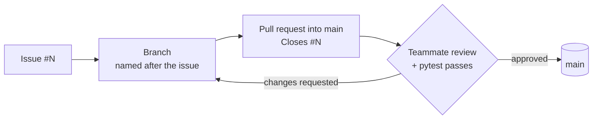

<div align="center">




<br><br>


**[Overview](#overview)** ·
**[Question](#research-question)** ·
**[Conditions](#the-four-conditions)** ·
**[How a run works](#how-a-run-works)** ·
**[Scenarios](#scenarios)** ·
**[File formats](#file-formats)** ·
**[Metrics](#what-we-measure)** ·
**[Architecture](#architecture-tools-and-flow)** ·
**[Quickstart](#quickstart)** ·
**[Glossary](#glossary)** ·
**[Team](#team)**

</div>

---

## Overview

- **The question:** does a second look make an AI financial advisor more reliable, and is it worth what it costs?
- **The experiment:** one advisor drafts an answer, then four verification strategies (none, self, peer, and a dedicated verifier with a calculator) check the same draft.
- **The grading:** synthetic client scenarios with known answers, graded by a deterministic scorer that no agent ever sees.
- **The goal:** find out which kind of check makes the advisor most reliable, and what each one costs in tokens and time.

## Research question

> **How do different verification strategies affect the correctness of a multi-agent financial advisory system on synthetic client scenarios?**

In plain words: *does a second look make an AI advisor more reliable, and is it worth what it costs?*

LLM agents can draft financial advice in seconds, and they sound just as confident when the arithmetic is wrong or a client's rule is broken. A client who acts on that advice loses real money. This project holds everything else fixed (scenarios, advisor model, prompts, the advisor's first draft) and changes one thing: **how the answer is verified**. Every answer is graded by a deterministic constraint checker that is never shown to any agent.

**Questions the study explores**

- Which verification strategy catches the most errors, and which one breaks the fewest correct answers?
- Does giving the verifier a calculator matter, and does a verifier from a different model family catch mistakes the advisor's own family misses?
- How much does each strategy cost per extra correct answer?
- Should the verifier be a stronger model than the advisor?

> [!IMPORTANT]
> `src/advisory/checker.py` and the scenario answer keys are for the scorer only. Keep them out of every prompt and every agent code path, so no agent can see what it is graded on.

## The four conditions

|     | Condition   | Who verifies              | What happens                                                                 |
|:---:|-------------|---------------------------|------------------------------------------------------------------------------|
| ⚪  | `none`      | Nobody                    | The advisor answers once; its output is final (baseline).                    |
| 🔁  | `self`      | The advisor itself        | The advisor reviews and revises its own answer.                              |
| 👥  | `peer`      | Another advisor           | A second, independent advisor in the same role critiques; the first revises. |
| 🛡️  | `dedicated` | A separate verifier agent | A verifier with its own prompt and a **sandboxed Python calculator** checks both the math and the rules. |

All four live in the `CONDITIONS` registry in `src/advisory/conditions.py`. One general advisor with the same prompt answers in every condition, and plain Python runs the workflow (no router agent), so any difference in results comes from verification alone.

**Verdicts.** Every checked answer ends in one of three outcomes:

| Verdict | What happens next |
|---|---|
| **Accept** | The answer becomes the final recommendation. |
| **Reject** | The advisor revises **once**, and the revision is verified again. |
| **Abstain, or rejected again after the revision** | The task goes to a **human review** queue. |

Every run ends with a final answer and a status: **accepted**, **revised**, **abstained** or **unchecked** (the `none` condition).

**Ablations.** To find out *why* the dedicated verifier works, it runs twice more with one setting changed: a **weakened verifier** without the calculator, and a **cross-family verifier** from a different model family than the advisor.

## How a run works

<p align="center">
  
</p>

<sub>**What the animation shows:** each gold dot is one scenario run. It leaves the scenario generator, passes through the advisor, takes one of the four verification paths (the highlighted lane), reaches the final answer and ends at the hidden checker. The dashed red line is the ground truth, which travels straight from the generator to the checker without touching any agent. The bars in the log strip light up as model calls are recorded.</sub>

1. **Generate.** `generator.py` builds a synthetic scenario with a known correct answer and saves it to `data/scenarios/`.
2. **Draft once.** The advisor returns a structured recommendation (defined in `schemas.py`). The draft is **saved once per task and repeat, then reused in every condition**.
3. **Verify.** The selected condition checks the draft (or doesn't) and produces the final answer: accepted, revised once, or sent to human review.
4. **Grade.** `checker.py` replays the trades at the quoted prices and tests every constraint against the hidden answer key. It grades **both the first draft and the final answer**, which is how fixed answers are told apart from broken ones. Any valid solution passes, not just one fixed answer.
5. **Log.** Every model call goes through `advisory.llm.call_model` and is appended to `results/runs.jsonl`, with tokens, cost and timing.

## Scenarios

The study starts from **10 scenario templates (S01–S10): 4 medium, 4 hard and 2 infeasible**, and grows to 30–40 scenarios by generating variants from them. Each scenario gives the advisor a natural client request plus separate structured data: the client profile, investment policy, portfolio holdings, asset prices, cash flows and restrictions. Everything is synthetic, and no real client data is used.

| Answer type | What the advisor must return |
|---|---|
| **TRADE_PLAN** | Trades as share changes (`quantity_delta`), or no trades when the request can't be met |
| **VIOLATION_LIST** | Every rule the portfolio currently breaks |
| **NUMERIC_RESULT** | Calculated values, such as fees, net returns or a retirement projection |

Every answer also carries a **status**: `FEASIBLE`, `INFEASIBLE`, `VIOLATIONS_FOUND` or `INSUFFICIENT_INFORMATION`.

**Trading assumptions:** fixed quoted prices, no transaction fees or taxes, no short selling, no borrowing, no deposits beyond those listed in the scenario, and whole shares wherever the scenario requires them.

**What each part sees:** agents receive the complete scenario file and their role prompt, nothing else. The evaluation files are read only by the scorer.

<details>
<summary><b>The ten scenario templates</b></summary>

| ID | Request | Difficulty | Answer type |
|---|---|---|---|
| S01 | Rebalance to 60/30/10, never sell AAPL | Medium | TRADE_PLAN |
| S02 | Fund a $25,000 expense, keep $12,000 cash | Medium | TRADE_PLAN |
| S03 | Find the five policy violations | Medium | VIOLATION_LIST |
| S04 | Compare two funds after fees | Medium | NUMERIC_RESULT |
| S05 | Rebalance under 25% stock and 35% tech caps | Hard | TRADE_PLAN |
| S06 | Retirement balance at month 240, extra contribution | Hard | NUMERIC_RESULT |
| S07 | Rebalance at new prices after a $12,000 deposit | Hard | TRADE_PLAN |
| S08 | Withdraw $20,000, then rebalance to 50/37.5/12.5 | Hard | TRADE_PLAN |
| S09 | Reach 40/50/10 without selling stock | Infeasible | TRADE_PLAN |
| S10 | Withdraw $80,000 | Infeasible | TRADE_PLAN |

S09 and S10 are infeasible on purpose: the right answer is the `INFEASIBLE` status with no trades, backed by the supporting numbers.

</details>

## File formats

**Scenario file** (`data/scenarios/S01.json` …, given to every agent unchanged)

| Field | What it holds |
|---|---|
| `scenario_id`, `schema_version`, `answer_type` | Identity of the task |
| `client` | Age, risk profile, goal and horizon, where relevant |
| `portfolio` | Holdings (symbol, asset class, quantity, price, value), cash and total value |
| `investment_policy` | Target allocations, restrictions and allocation tolerance |
| `cash_flows` | Listed deposits and withdrawals |
| `client_request` | The client's request in plain language |
| `assumptions` | The approved trading assumptions |
| `output_requirements` | The output contract the answer must follow |

**Answer format** (`NEUTRAL_OUTPUT_V1`, one contract for every scenario and condition)

| Field | What it holds |
|---|---|
| `status` | `FEASIBLE`, `INFEASIBLE`, `VIOLATIONS_FOUND` or `INSUFFICIENT_INFORMATION` |
| `trades` | `[{symbol, quantity_delta}]`: positive to buy, negative to sell, `[]` when no trades are proposed |
| `metrics.observations` | Reported numbers, each identified by subject, measure, stage and rounding |
| `metrics.selection` | The chosen option when the client compares named options, otherwise `null` |
| `violations` | `[{kind, scope, observed, limit}]` for policy audits |
| `explanation` | A short explanation of the recommendation and calculation |

**Evaluation files** (scorer only)

| File | What it holds |
|---|---|
| `checks.json` | The checks for each scenario, such as schema, status, trade replay, independent results and exact violations |
| `ground_truth.json` | Reference results for each scenario |
| `metric_mapping.json` | How the scorer derives each number from the scenario and the answer |

The scorer never fills in a reference value for a number the advisor failed to report. The underlying data model has 17 tables, covering clients and portfolios, policies, tasks and answer keys, and runs and results.

**Per-run results** (input to `metrics.py`, one row per run): `task_id`, `condition`, `run_number`, `initial_correct`, `final_correct`, `verdict`, `tokens_in`, `tokens_out`, `cost_usd`, `latency_s`.

## What we measure

Metrics come from `src/advisory/metrics.py`, which turns one row per run into one row of metrics per condition with `summarize(runs, seed=0)`.

| Group | Metric | What it tells us |
|---|---|---|
| **Outcome** | **Task success** | Share of final answers that pass the checker, with a 95% bootstrap confidence interval |
| **Verifier** | **Catch rate** | Share of wrong drafts the verifier flags |
| | **Precision** | Share of flags that point at a real error |
| | **False-alarm rate** | Share of correct drafts the verifier wrongly flags |
| | **MCC** | One balanced score for how well the flags separate wrong drafts from correct ones |
| | **Abstention rate** | Share of runs sent to human review |
| **Fixed vs broken** | **Fix rate** | Share of wrong drafts that end up correct after verification |
| | **Break rate** | Share of correct drafts that verification turns wrong |
| | **Net gain** | Fix rate minus break rate |
| **Cost** | **Cost, tokens and latency** | Total and mean cost, mean tokens, median and p95 latency |
| | **Extra cost per extra correct answer** | What each condition pays, compared with `none`, for every additional correct answer |

Verifier metrics use runs that have a verdict, and an abstain counts as a flag, just like a reject. Runs without a verdict are reported as `n_missing_verdict`. Rates that can't be computed are reported as `None`; MCC follows scikit-learn and is 0 when it can't be computed.

**Study settings**

- **Repeats:** every scenario runs 5 times per condition, at temperature 0.7 so repeats can differ.
- **Statistics:** the bootstrap resamples tasks, not runs, and conditions are compared in pairs on the same tasks.
- **Budget:** at most about 7M tokens across all six settings (four conditions plus two ablations).
- **Something to catch:** a model that never makes mistakes leaves verification nothing to do, and one that breaks the output format fails before the math matters. The advisor model is chosen with a pilot run so that it is right about **50–80%** of the time, and answers with **known injected errors** are added so every verifier faces real mistakes.

## Architecture, tools and flow

<p align="center">
  
</p>

<sub>**What the animation shows:** one task plays through three lanes in a loop of about 14 seconds. **Develop:** a change moves from a teammate's branch through a pull request and pytest (a ✓ appears) into main. **Run:** the task drops into `scripts/`, then passes through the generator and the scenario files into `conditions.py`, where the four conditions light up in turn, and on to `llm.py`, which exchanges calls with the LLM API. **Evaluate:** the final answer and the red ground-truth line meet at `checker.py` (a ✓ appears), run logs flow from `runs.jsonl`, and both feed the metrics and the report. The pills and the progress bar at the top show which lane is playing.</sub>

| Layer | Tools |
|---|---|
| **Develop** | Git branches, GitHub pull requests, `pytest` |
| **Run** | Python 3.10+, Pydantic schemas, a sandboxed Python calculator for the dedicated verifier, LLM API through `advisory.llm.call_model`, keys in `.env` |
| **Data** | JSON scenarios in `data/scenarios/`, JSONL run logs in `results/` |
| **Evaluate** | Deterministic `checker.py`, `metrics.py` (with scikit-learn), analysis entry points in `scripts/` |

**Who reads and writes what**

| Component | Reads | Writes |
|---|---|---|
| Generator | Templates | Scenario files (public) and evaluation files (private) |
| Advisor | Scenario file + advisor prompt | First draft, then at most one revision |
| Verifier | Scenario file + draft + verifier prompt (`dedicated` also has the calculator) | Verdict and findings |
| `llm.py` | Every prompt and response | `results/runs.jsonl` |
| Scorer | Scenario file + answers + evaluation files | Per-run results |
| `metrics.py` | Per-run results | One row of metrics per condition |

Two rules hold everywhere: no agent ever reads the evaluation files, and the scorer only writes results; it never changes an answer.

## Repository layout

```text
src/advisory/
  llm.py          single wrapper for all model calls; logs to results/runs.jsonl
  schemas.py      Pydantic models for the advisor's structured answer
  conditions.py   the four conditions and the CONDITIONS registry
  checker.py      deterministic constraint checker (hidden from agents)
  generator.py    synthetic client scenario generator
  metrics.py      per-condition metrics: task success, verifier, fixed vs broken, cost
tests/            pytest suite
data/scenarios/   scenario files (S01.json … S10.json)
results/          run logs and metrics (runs.jsonl)
docs/             proposal, notes
assets/           README images and animations
scripts/          entry points for generating, running and analysing
pyproject.toml    package metadata and dependencies (pip install -e ".[dev]")
.env.example      template for your local .env (API keys)
.gitignore        keeps .env, caches and local files out of git
```

## Quickstart

```bash
git clone https://github.com/bhoomi02-ai/cs5130-verification-advisory.git
cd cs5130-verification-advisory
python3 -m venv .venv
source .venv/bin/activate
pip install -e ".[dev]"
cp .env.example .env   # fill in your own keys; .env is gitignored
pytest
```

Requires **Python 3.10 or newer**. Entry points for generating scenarios, running conditions and analysing results live in `scripts/`.

> [!WARNING]
> Never commit `.env` or any API key. If a key is ever pushed, revoke it right away; deleting the commit is not enough.

## Contributing workflow



- **One branch per task**, named after the issue, e.g. `generator/scenario-schema`.
- **Open a pull request into `main`** and link the issue (`Closes #N`).
- **At least one teammate reviews** before merging, and `pytest` must pass.
- **Every model call goes through `advisory.llm.call_model`** so it is logged.
- **Pin exact model strings** (dated snapshots), never aliases, so runs are reproducible.

## About the animated diagrams

All images live in `assets/` as self-contained SVG files. They animate on their own, with no scripts or outside services, so they play anywhere GitHub shows the README.

| File | What it shows |
|---|---|
| `banner.svg` | The project title, with the advisor sending answers through the four checkers to the hidden checker |
| `tagline.svg` | Three lines typed out in a loop: the question, the setup, and what is measured |
| `pipeline.svg` | One scenario run through the four verification paths, with the hidden ground truth and the log |
| `architecture.svg` | The whole system as a story: develop, run, evaluate |

## Glossary

| Term | Meaning |
|---|---|
| **Advisor** | The AI agent that drafts the answer to a client request |
| **Verifier** | The agent that checks a draft: the advisor itself (`self`), a second advisor (`peer`) or a separate checker (`dedicated`) |
| **Condition** | One way of verifying an answer; the study compares four |
| **Ablation** | A variant of the dedicated verifier with one setting changed, to see which part matters |
| **Scenario** | One synthetic client task with a known correct answer |
| **First draft** | The advisor's first answer, saved once and reused across conditions |
| **Verdict** | The verifier's decision: accept, reject or abstain |
| **Abstain** | The verifier declines to decide, and the task goes to human review |
| **Scorer / checker** | The deterministic program that grades answers against hidden checks |
| **Ground truth** | The reference results, seen only by the scorer |
| **Catch rate** | Of the wrong drafts, the share the verifier flagged |
| **False alarm** | A correct draft the verifier flagged anyway |
| **Fixed / broken** | A wrong draft that ended up correct, or a correct draft that ended up wrong |
| **MCC** | Matthews correlation coefficient: one score for how well flags line up with real errors |
| **`quantity_delta`** | A trade expressed in shares: positive to buy, negative to sell |
| **`NEUTRAL_OUTPUT_V1`** | The answer format every agent must follow |

## Responsible use

> [!CAUTION]
> This is a research prototype. Outputs are decision support on synthetic scenarios, not financial advice, and say nothing about real clients. No real client data is used, and the verifier can abstain and send a task to human review when it cannot confirm a claim.

## Team

<table align="center">
  <tr>
    <td align="center" width="25%"><b>Bhoomika Monthy Rajashekar</b><br><sub><a href="https://github.com/bhoomi02-ai">@bhoomi02-ai</a></sub></td>
    <td align="center" width="25%"><b>Dhanya Kini Bailoor</b><br><sub><a href="https://github.com/dhanyakini">@dhanyakini</a></sub></td>
    <td align="center" width="25%"><b>Faisal Alsabih</b><br><sub><a href="https://github.com/FaisalNAlsabih">@FaisalNAlsabih</a></sub></td>
    <td align="center" width="25%"><b>Tejas Prashant Vanjari</b><br><sub><a href="https://github.com/vanjaritejas">@vanjaritejas</a></sub></td>
  </tr>
</table>

---

<div align="center">
<sub>Northeastern University · CS 5130 · Theme 6: Agentic Systems</sub>
</div>
